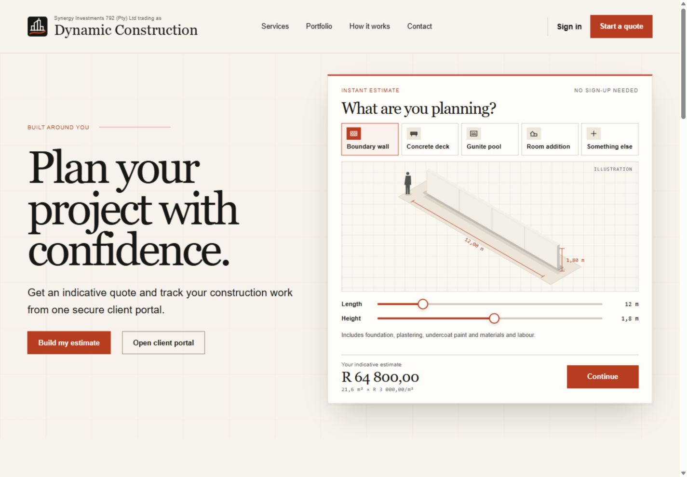
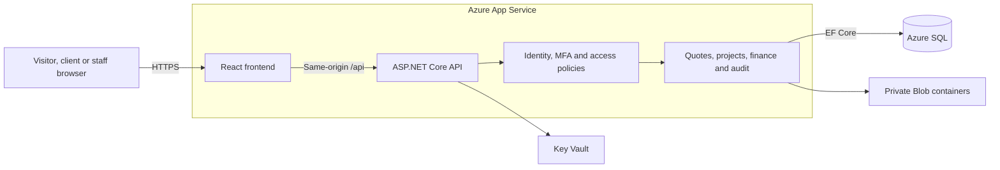
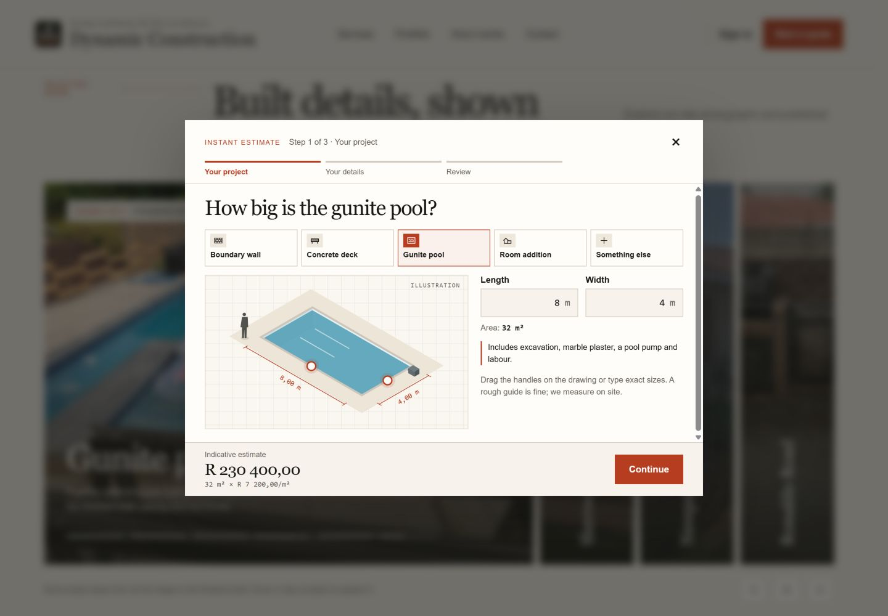
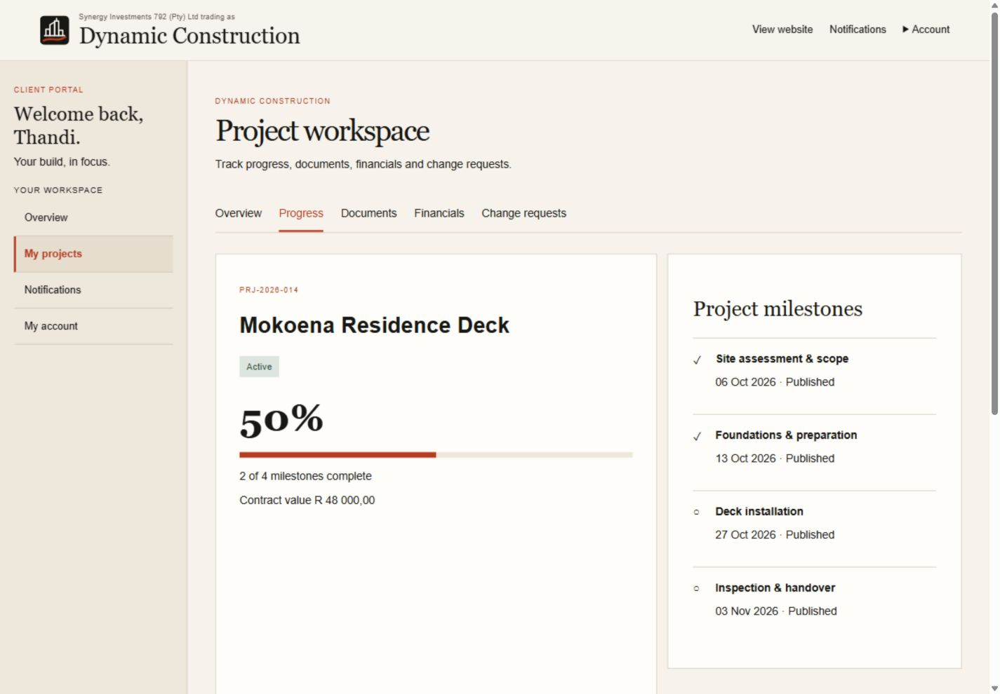
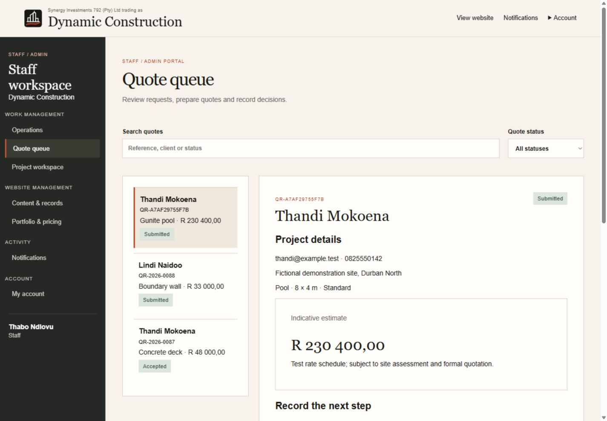
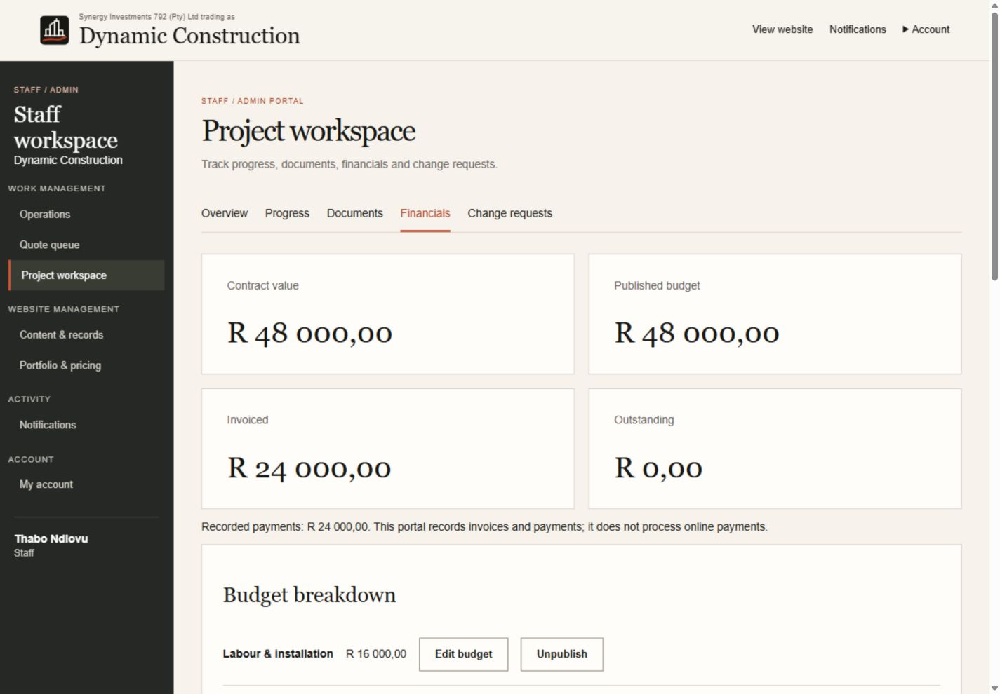
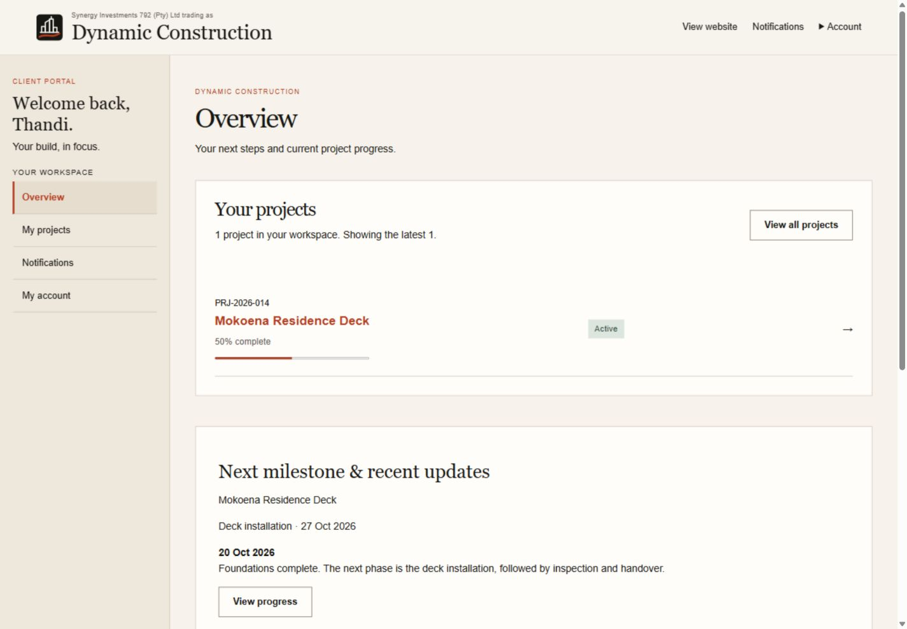
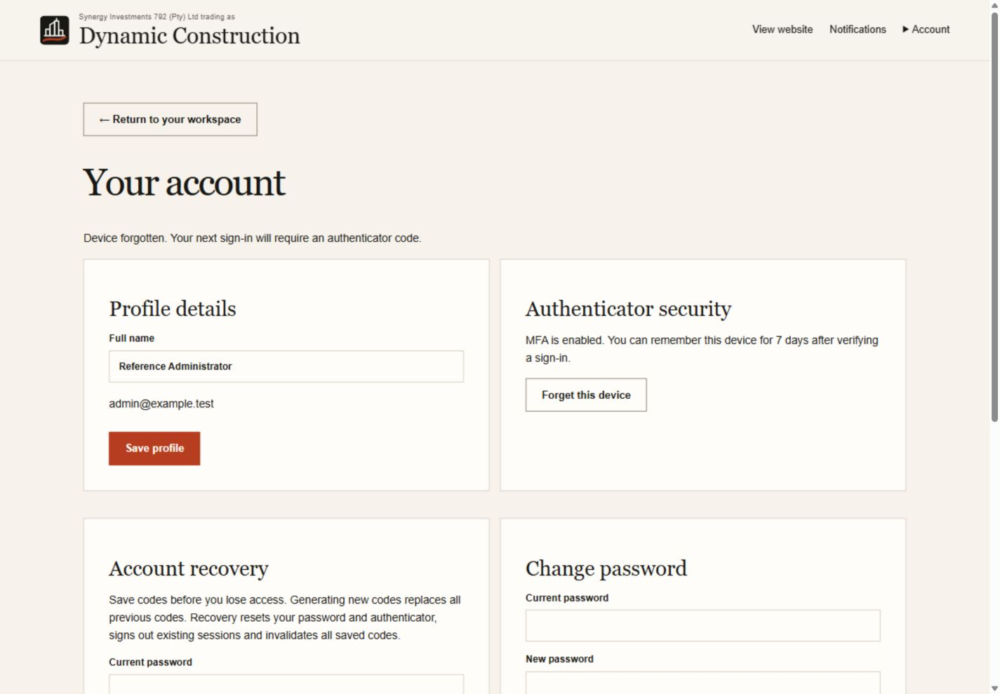
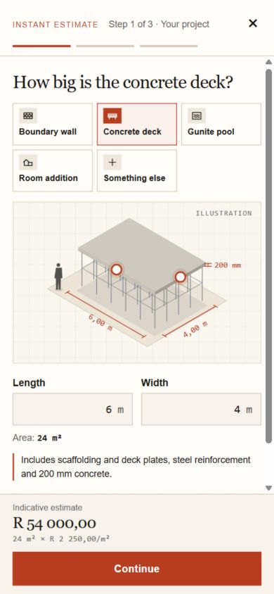

# Dynamic Construction

A web platform for Dynamic Construction, a residential construction business. It combines a public website with an instant quote builder, a client portal for following a build, and a staff workspace for quotations, project delivery and finance. The frontend is React with TypeScript, and the backend is an ASP.NET Core API with EF Core and ASP.NET Core Identity, designed to run on Azure.

Built by a team of four for INSY7315 at Emeris Durban North (2026).

**Live site:** [Open the app](https://app-dc-pilot-kc023-bhesg0a5g8ewhken.southafricanorth-01.azurewebsites.net/)

**Demo video:** [Watch on YouTube](https://youtu.be/r0GW_skkptA)



## Features

- **Instant estimates:** a three-step quote builder for boundary walls, concrete decks, gunite pools and room additions, with interactive drawings, server-managed rates and saved pricing assumptions. Anything else is captured as a custom request for pricing after a site assessment.
- **Client portal:** linked projects with published milestones, progress, documents, financial summaries and change requests.
- **Staff workspace:** quotation review and acceptance, project conversion, lifecycle transitions, milestone publishing and private document access.
- **Finance:** budgets, invoices, payments and outstanding balances, with validation and concurrency checks. Payments are recorded, not processed online.
- **Administration:** accounts, roles, suspension, notifications, audit records, pricing and public content management.
- **Account security:** authenticator-app MFA, optional seven-day trusted devices, recovery codes and immediate form validation.
- **Responsive design:** accessible, labelled forms and keyboard support across desktop and mobile layouts.

## Security and data integrity

- **Sessions and access:** ASP.NET Core Identity cookies, role-based access for staff and administrators (with MFA required in production), and per-resource ownership and publication checks on projects, documents and finance records.
- **CSRF protection:** the frontend fetches an antiforgery token and sends it with every protected write.
- **Account recovery:** recovery codes reset the authenticator, revoke existing sessions and invalidate old codes; they cannot bypass suspension or lockout.
- **Data integrity:** server-side validation of quote inputs, rates and state transitions; optimistic concurrency checks reject stale updates; database constraints and idempotency checks protect duplicate-sensitive operations.
- **Audit trail:** important business changes are audited, and the runtime database identity cannot modify existing audit records.
- **Secrets and keys:** the hosted app reaches Azure SQL through a managed identity, and identity keys are stored in private Blob Storage, encrypted with a Key Vault key.

## Tech stack

| Area | Technologies |
| --- | --- |
| Frontend | React 19, TypeScript, Vite, React Router |
| Backend | C#, ASP.NET Core (.NET 10), EF Core, ASP.NET Core Identity |
| Data | Azure SQL (SQL Server), SQLite for local development |
| Cloud | Azure App Service, Blob Storage, Key Vault, Application Insights |
| Testing | xUnit, Vitest, Playwright (desktop and mobile Chromium), Python API and security regression suites |
| CI | GitHub Actions |

## Architecture



One App Service serves the React build and the `/api` routes from the same origin. The API is organised by feature, with controllers and services for quotes, projects, finance, identity and administration. Local development swaps Azure SQL and Blob Storage for SQLite and local files.

## Screenshots

| Quote builder | Client project progress |
| --- | --- |
|  |  |

| Staff quote queue | Project finance |
| --- | --- |
|  |  |

| Client overview | Account security |
| --- | --- |
|  |  |

<details>
<summary>Mobile quote builder</summary>



</details>

All account and project data shown is fictional demonstration data.

## Getting started

### Prerequisites

- Node.js 22.13 or later (22.x)
- .NET 10 SDK (the version is pinned in `global.json`)
- For the full regression suites: Python 3.12, a disposable SQL Server database and Playwright Chromium

### 1. Install and check

```bash
npm run setup
npm run check
```

`setup` restores .NET tools and locked dependencies; `check` builds the app and runs the xUnit and Vitest tests.

### 2. Create a local administrator

```bash
export ASPNETCORE_ENVIRONMENT=Development
export Database__Provider=Sqlite
export Storage__Provider=Local
export ConnectionStrings__Database='Data Source=App_Data/dynamic.db'
read -rp 'Administrator email: ' Bootstrap__Email
read -rsp 'Administrator password: ' Bootstrap__Password; echo
export Bootstrap__Email Bootstrap__Password
dotnet run --project src/DynamicConstruction.Api --no-launch-profile -- --bootstrap-admin
unset Bootstrap__Email Bootstrap__Password
```

The password needs at least 12 characters with uppercase, lowercase, a digit and a symbol. Bootstrap only runs when no administrator exists.

### 3. Run the app

```bash
npm run dev
```

Open `http://127.0.0.1:5173`. The frontend proxies API requests to port 5080, and `http://127.0.0.1:5080/api/health` checks database connectivity. Sign in, enrol MFA from `/profile`, then publish business content and rates before creating quotes.

Local data, uploaded files and development keys are stored in `App_Data/`, which is ignored by Git. `.env.example` documents the production settings.

### Publish

```bash
npm run publish -- --output artifacts/release-1
```

This builds the React app into the API's `wwwroot` so both can be deployed as one package. `scripts/smoke-hosted.py <url>` checks a running deployment's pages, headers, routing and API access restrictions.

## Testing

- **Unit tests:** xUnit for business rules, identity validation, trusted devices and query efficiency; Vitest for the frontend.
- **Regression suites:** Python suites in `tests/` exercise the SQL-backed API, identity and MFA, access control and administrator bootstrap against a disposable database, with fixtures loaded by `tests/FixtureLoader`.
- **Browser tests:** Playwright covers the quote flow, custom requests, navigation, registration validation, trusted-device MFA and recovery on desktop and mobile Chromium (`npm run test:e2e` in `src/web`).
- **CI:** the GitHub Actions workflow builds the frontend and backend, applies migrations to a temporary SQL Server container, runs the unit, API, security and browser suites, and smoke-tests the published package. A separate load check (`tests/load.py`) runs locally. It is set to run manually.

## Project structure

```text
src/DynamicConstruction.Api/   ASP.NET Core API, Identity, domain and EF Core migrations
src/web/                       React frontend, styles and Playwright tests
tests/                         xUnit tests, fixture loader and Python regression suites
scripts/                       Local setup, start-up, checks and publishing
docs/                          Screenshots
```

## Team

| Member | Role | Contribution |
| --- | --- | --- |
| Khayden Chetty | Designer | Public website and estimates, pricing and published content, visual design and Azure hosting |
| Rivaan Kawulesar | Developer | Data model and migrations, client portal and finance, CI/CD pipeline, MFA improvements and trusted devices |
| Stephane Nsengiyumva | Tester | Quote queue and project workspace, lifecycle rules, files and change decisions, and the regression-test foundation |
| Zenwyn Naicker | Project Manager | Identity, security, administration and audit, the quote builder and portal UX, performance and release documentation |

## Acknowledgements

Frameworks, libraries and adapted implementation patterns are credited in [CODE_ATTRIBUTION.txt](CODE_ATTRIBUTION.txt).
